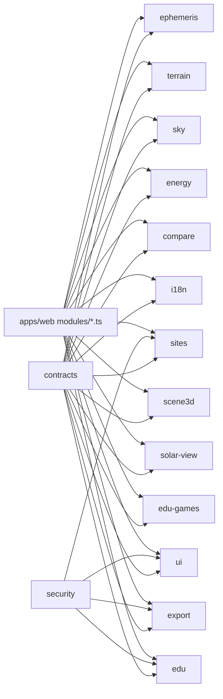

# Design Document

## Overview

Language: TypeScript (strict, Vite, Three.js, pnpm workspaces, vitest). Python only in `tools/*-data` generators. Each package is implemented behind the contract types in `packages/contracts/src/index.ts`, which are not changed. Needs that the contract cannot express are recorded as "Solicitud al contrato" in the package doc and in `docs/INTEGRACION.md`.

The existing base is reused: `@lunar/contracts` (types, `APOLLO_SITE_IDS`, `ManifestSchema`, `registerPanelTab`/`getPanelTabs`), `@lunar/security` (validators, `sanitizeText`, `loadClassPackage`), `apps/web` (Vite, `__LUNAR_DEMO__`), `tools/lint`, `.semgrep/rules.yml`, `public/assets/manifest.json`.

## Architecture

Packages never import each other except through contract types. Cross-module collaboration is by injection (for example `computeSiteMetrics(deps, site, ...)` receives an `EphemerisService` and a `TerrainService`). Only `apps/web` knows all packages.



## Components and Interfaces

### Shell registration (apps/web)

Each module owns exactly one file `apps/web/src/modules/<name>.ts` that default-exports a `WebModule`. The shared types live in `apps/web/src/modules/context.ts` (created by task 2.1).

```ts
export interface WebServices {
  sites?: { list(): LunarSite[]; add(site: LunarSite): void };
  ephemeris?: EphemerisService;
  ephemerisMeta?: { source: string; approximate: boolean; note: string };
  terrain?: TerrainService;
  scene?: SceneApi;
  i18n?: I18nApi & { addResources(ns: string, dict: Record<string, Record<string, string>>): void };
  time?: TimeController;
  solarView?: () => SolarPanelViewApi;
  exportReport?: (data: ReportData) => Promise<Uint8Array>;
  metrics?: (site: LunarSite, startUtc: string, endUtc: string, stepMin: number) => Promise<SiteMetrics>;
}
export interface WebContext {
  readonly demo: boolean;
  readonly services: WebServices;
  readonly assetUrl: (relativePath: string) => string;   // resolves under /assets
  readonly dataUrl: (relativePath: string) => string;    // resolves files from /data via Vite glob
}
export interface WebModule {
  id: string;
  setup(ctx: WebContext): Promise<void> | void;  // sets services and calls registerPanelTab
}
```

`apps/web/src/main.ts` loads modules with dynamic `import()` in dependency order, catches per-module errors and shows the error screen without stopping the rest.

### Packages

| Package | Public API (src/index.ts) | Notes |
|---|---|---|
| security | existing + clean lint | `loadClassPackage`, `ClassPackageSchema`, `validateManifest` |
| sites | `loadSites`, `parseSites`, `validateCustomSite`, `createTimeController`, `mountTimeline`, `mountSiteList` | `data/sites/sites.json`; unverified sites go to `data/sites/pending-sites.json` without coordinates |
| ephemeris | `createEphemerisService(source, horizonAt)`, `BinarySource`, `AnalyticSource`, `getEphemerisMeta` | `VectorSource.sunEarth(utcMs, out)` returns km vectors in the Moon-fixed frame |
| terrain | `createTerrainService`, `sphericalHorizon`, `computeHorizonFromDem` | profiles in `data/terrain/<siteId>.json` |
| sky | `computeSiteMetrics`, `renderSkyDiagram`, `createCountdown`, tab `sol-tierra` | tab registered by Module_File |
| energy | `methods` (one file each), `computeSeries`, `createBattery`, charts, tab `energia` | tab contains an empty container for `SolarPanelViewApi` |
| compare | `buildScenarios`, `compareMetrics`, `viabilityIndex`, `sensitivity`, charts, tab `comparar` | at most 3 scenarios |
| i18n | `createI18n`, `languageFocus` table, es/en locales, templates | menu lives in `packages/ui/src/menu` |
| export | `exportReport`, `toCsv`, `svgToPng`, print stylesheet | pdf-lib |
| ui | design tokens (`--ln-*` CSS variables), `openSitePanel`, `mountAbout`, `createMenu` | menu from task 9.3, panel and design from 11.x |
| scene3d | `createScene(canvas, opts): SceneApi & {dispose, debug}` | state machine for 5 modes, GLB loader with Placeholder |
| solar-view | `createSolarPanelView(): SolarPanelViewApi` | procedural panel unless a GLB exists in the manifest |
| edu | `createTrivia`, `questionBank`, `createClassSession`, `exportClassPackage`, `mountCalculatorMode` | class packages validated by `loadClassPackage` |
| edu-games | `projectileGame`, `blocksGame`, `explorerGame` | independent entry points |

### Data decisions

- Ephemeris frame: Moon-fixed (principal axes) with libration; positions in km. `AnalyticSource` follows Meeus, "Astronomical Algorithms", chapters 25, 47 and 53, and is labeled approximate in the UI and docs. Accuracy against Horizons is PENDIENTE until the comparison script runs.
- Apparent radius uses the upper limb of the Sun and the Earth for rise and set. No refraction.
- Spherical horizon fallback: reference radius 1737.4 km (IAU mean radius), horizon 0 degrees, `demResolutionM = 1737400` as a documented sentinel and `demSource` starting with "PENDIENTE".
- Solar constant default 1361 W/m2 at 1 AU (AU = 149597870.7 km), scaled by the inverse square of the Sun-Moon distance. Panel area and efficiency defaults are illustrative and flagged "ejemplo editable, PENDIENTE fuente".
- Lunar gravity 1.62 m/s2 and Earth gravity 9.80665 m/s2 in games, with source noted in the doc.
- Data files are loaded in the App with `import.meta.glob` and `?url`, so a missing file does not break the build.
- Country focus table (language to lat/lon) is cosmetic; values are generated from Natural Earth by `tools/i18n-data` or flagged `verified: false`.
- Existing GLBs (`Aeronomy of Ice in the Mesosphere.glb`, `Earth_1_12756.glb`, `Moon_1_3474.glb`) are added to the manifest by the scene task with credit "PENDIENTE (confirmar origen)". GLB files are never created or edited.

## Data Models

Contract types only. Additional file formats: `data/sites/sites.json` (`LunarSite[]`), `data/sites/pending-sites.json` (`{id,name,program,sourceToConfirm}[]`), `data/terrain/<siteId>.json` (`HorizonProfile`), `data/ephemeris/ephemeris.json` and `.bin` (`EphemerisBinaryHeader`).

## Error Handling

All user input goes through `@lunar/security` and returns `Result<T>`. Missing data or assets produce a Placeholder or Pending_Marker and an entry in the runtime missing-asset list shown in the debug view; they never throw. Module load errors show an error screen naming the module. CSP: `default-src 'self'; connect-src 'self'; img-src 'self' data: blob:; script-src 'self'; style-src 'self'; worker-src 'self' blob:`. WebAssembly decoders (Draco/KTX2) need `'wasm-unsafe-eval'` in `script-src`; this is documented in `docs/SEGURIDAD.md`.

## Correctness Properties

*A property is a characteristic or behavior that should hold true across all valid executions of a system. Decision: the user asked for no property-based tests, so each property below is checked with focused example-based vitest tests over a table of representative inputs.*

### Property 1: Sky angle ranges

For any site and any UTC instant in range, `getSky` returns azimuth in [0, 360) and elevation in [-90, 90].

**Validates: Requirements 3.1**

### Property 2: Ephemeris binary round trip

For any valid synthetic header and rows, writing then reading `ephemeris.bin` returns the same values and a matching SHA-256.

**Validates: Requirements 3.5**

### Property 3: Metrics ranges

For any site and interval, `computeSiteMetrics` returns fractions in [0, 1], hours greater than or equal to 0 and `demResolutionM` greater than 0.

**Validates: Requirements 5.1**

### Property 4: Power is zero below the horizon

For any energy method and any `SkyState` where `sun.aboveTerrainHorizon` is false, `powerW` is 0.

**Validates: Requirements 5.2**

### Property 5: Custom coordinate validation

For any latitude outside [-90, 90] or any non-finite value, `validateCustomSite` returns `ok: false` with an error naming the field.

**Validates: Requirements 2.2**

### Property 6: Locale key parity

For any supported language, the set of keys of every core namespace equals the set of keys of the `en` namespace.

**Validates: Requirements 6.5**

## Testing Strategy

A few focused vitest unit tests per package (no property-based tests, no optional tests). Pure logic (math, state machines, validators, formatters) is tested in Node; DOM code uses jsdom; Three.js code is tested through pure helpers and mocked renderers. Data scripts in Python are run by the user when network access exists; their output tables stay empty (PENDIENTE) otherwise.
