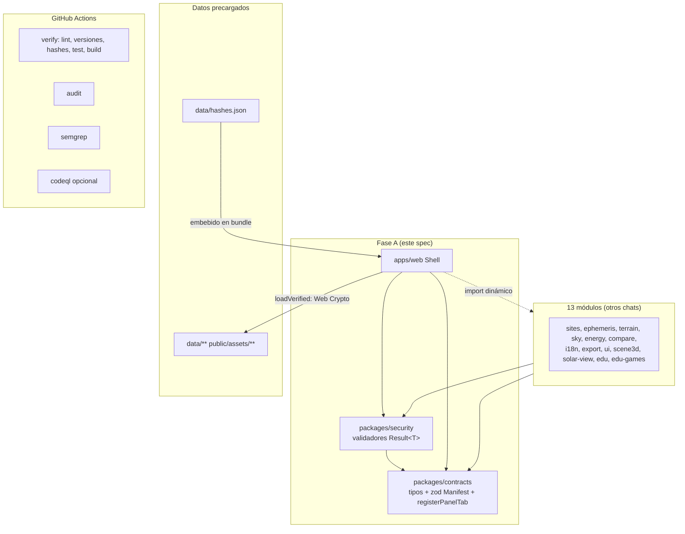
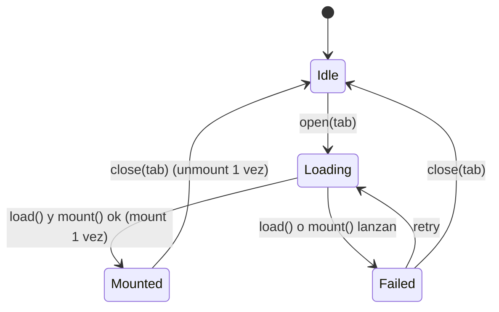
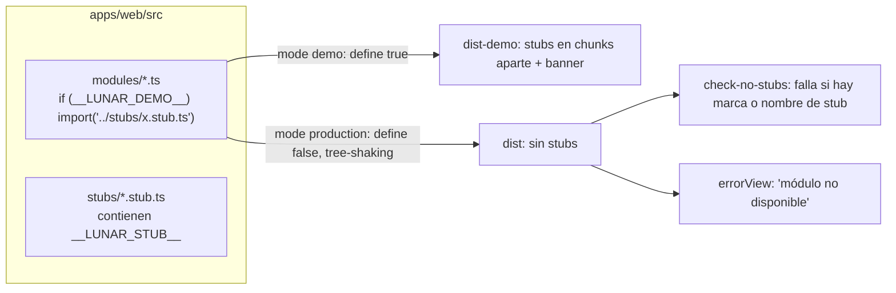

# Design Document

## Overview

Este diseño cubre la Fase A de "Lunar Landing Site Navigator": la base que permite a 14 módulos (13 paquetes más el Shell `apps/web`) integrarse sin conflictos. Entrega:

1. **`packages/contracts`**: tipos, interfaces, esquema zod del Manifest y `registerPanelTab`. Sin lógica de negocio (Requirement 16.4).
2. **`packages/security`**: validadores zod que devuelven `Result<T>`: latitud, longitud, fecha UTC, id de sitio, nombres, Class_Package y Manifest.
3. **`apps/web`**: Shell vanilla TypeScript + Vite con stubs (solo en modo `demo`; el modo `production` los excluye y lo verifica el build), carga perezosa, pantalla de error, CSP, verificación de integridad en runtime.
4. **Cadena de suministro**: `.npmrc`, versiones exactas, ESLint, Semgrep, CodeQL opcional, `pnpm audit`, flujos de GitHub Actions fijados por SHA, hashes SHA-256 de los datos precargados.
5. **Documentación**: `docs/SEGURIDAD.md`, `docs/INTEGRACION.md`, `docs/MODULO-contracts.md`, `docs/MODULO-security.md` (esta última pareja la exige `docs/CONTRATO.md`).

### Estado actual del repositorio (hallazgos que condicionan el diseño)

- `packages/contracts/src/index.ts` ya define `Program`, `LunarSite`, `BodyState`, `SkyState`, `HorizonProfile`, `EphemerisService` (`getSky`, `getSeries`), `TerrainService`, `EnergyResult`, `EnergyMethod`, `Result<T>`. Sus comentarios de unidades son informales (`// -90..90, ...`) y `lonDeg` dice `-180..180`; se reescriben solo los comentarios para cumplir el Requirement 2.6 y la Longitud_Canonica `(-180, 180]`. No cambia ningún tipo.
- Los demás paquetes son `export {}` con `tsconfig.json` que extiende `tsconfig.base.json` (`strict`, `noUncheckedIndexedAccess`, `moduleResolution: Bundler`, `isolatedModules`). `packages/*/package.json` solo tienen el script `test` (`vitest run --passWithNoTests`).
- `package.json` raíz: `typescript ^7.0.2`, `vitest ^5.1.0` (a fijar en `7.0.2` y `5.1.0`). No existen `.npmrc`, `.github/`, ESLint ni `docs/SEGURIDAD.md`.
- `public/assets/manifest.json` existente tiene forma `{ version, models[], textures[] }` con rutas que empiezan por `/` (`/assets/models/apollo-lm.glb`). **El Requirement 5.6 rechaza rutas que empiezan por `/`**, y `tools/validate-assets.ps1` asume esa forma. Ver "Migración del manifest".
- `tools/validate-assets.ps1` ya existe (lo usa `.kiro/steering/assets-3d.md`) y debe seguir funcionando tras la migración.
- Node 22.18, pnpm 12.18. Versiones vigentes consultadas en el registro de npm: `zod 4.6.7`, `fast-check 4.10.2`, `vite 8.3.8`, `eslint 10.15.0`, `typescript-eslint 8.72.2`, `eslint-plugin-security 4.2.1`, `jsdom 31.0.1`. Se fijan con `pnpm add --save-exact` al ejecutar las tareas.

### Decisiones fijadas por el usuario (se respetan sin cambios)

| Tema | Decisión |
|---|---|
| `PanelTab` ctx | `PanelContext = { site: LunarSite; utc: string }` |
| `setSiteMarkers` | `setSiteMarkers(sites: LunarSite[])` |
| Longitud | El validador acepta -180..360 y devuelve siempre un valor en (-180, 180]; nunca 0..360 |
| Análisis estático | Semgrep obligatorio; CodeQL opcional que no rompe el flujo |
| Datos sin generar | Los archivos PENDIENTE se listan en la salida de la verificación (ruta, estado, fuente), no la fallan |
| `EnergyInput`, `ReportData` | Tipos mínimos exportados desde Contracts (ver Data Models) |

### Decisiones tomadas en este diseño

#### D1. Plugin de seguridad de ESLint: `eslint-plugin-security`

- **Elegido**: `eslint-plugin-security` (4.2.1, configuración flat `configs.recommended`). Peer `eslint ^8.57 || ^9 || ^10`; una sola dependencia propia (`safe-regex`).
- **Por qué**: cubre `detect-eval-with-expression`, `detect-non-literal-regexp`, `detect-unsafe-regex`, `detect-child-process`, `detect-non-literal-fs-filename`, etc., que son los patrones relevantes para el parser de Class_Package, los scripts de hashes y los validadores. Es el plugin de seguridad genérico más usado y mantenido.
- **Excepción acotada**: `security/detect-non-literal-fs-filename` está desactivada solo para `packages/*/scripts/**` y `tools/**` (CLIs de build que leen archivos del repositorio con rutas calculadas desde la raíz). Sigue en `error` en `src` de los paquetes y en `apps/web/src`.
- **Alternativa descartada**: `eslint-plugin-no-unsanitized`. Su regla `property` admite valores "saneados" con funciones de escape configurables, pero el Requirement 12.6 exige un criterio más estricto y simple: solo literales de cadena constantes. Se implementa sin dependencia extra con `no-restricted-syntax` (selectores esquery) para `innerHTML`, `outerHTML` e `insertAdjacentHTML`.
- **Configuración** (`eslint.config.js`, todo en nivel `error`): `no-eval`, `no-new-func`, `no-implied-eval`, `no-script-url`, todas las reglas de `security.configs.recommended` promovidas a `error`, y:
  ```js
  'no-restricted-syntax': ['error',
    { selector: "AssignmentExpression[left.property.name=/^(innerHTML|outerHTML)$/][right.type!='Literal']:not([right.type='TemplateLiteral'][right.expressions.length=0])",
      message: 'innerHTML/outerHTML solo con literal constante' },
    { selector: "CallExpression[callee.property.name='insertAdjacentHTML'][arguments.1.type!='Literal']",
      message: 'insertAdjacentHTML solo con literal constante' },
    { selector: "MemberExpression[property.name=/^(skip|todo|only|skipIf|runIf)$/][object.name=/^(it|test|describe)$/]",
      message: 'Pruebas omitidas no permitidas (Requirement 9.8, 16.6)' } ]
  ```
- **Decisión firme (Requirement 12.5)**: `security/detect-object-injection` está en `off` en todo el repositorio y en `error` solo en `packages/security` y `apps/web/src/security`.
  - **Justificación**: la regla marca cualquier `obj[variable]`, lo que produce falsos positivos masivos en código numérico con `Float64Array`, `Record<string, number>` y tablas indexadas (efemérides, terreno, energía). El riesgo real (claves de prototipo en entrada del usuario) vive en los dos lugares donde sí se activa: el código que valida entradas y el código de seguridad del Shell.
  - **Configuración**: un bloque base con la regla en `off` y un bloque `files: ['packages/security/**/*.ts', 'apps/web/src/security/**/*.ts']` que la sube a `error`. Una prueba con `ESLint.lintText` comprueba ambos comportamientos (`obj[k]` falla bajo `packages/security/src/x.ts` y pasa bajo `packages/sky/src/x.ts`).
  - **Controles compensatorios**: (1) pruebas de contaminación de prototipo en `packages/security` (`__proto__`, `constructor.prototype`, hasta 5 niveles; Requirements 8.9 y 9.5), que son entregable de ese paquete; (2) regla Semgrep local que marca acceso con corchetes cuyo índice sea `__proto__`, `constructor` o `prototype` (literal o variable con ese nombre); (3) `noUncheckedIndexedAccess` de TypeScript, ya activo en `tsconfig.base.json`.
  - Esta es la única excepción al nivel `error` del Requirement 12.5 y se registra en `docs/INTEGRACION.md`.
- **Riesgo**: `typescript-eslint 8.72.2` declara `typescript >=4.8.4 <6.1.0` como peer, y el repositorio usa `typescript 7.0.2`. La tarea de ESLint comienza con una prueba de humo (`eslint` sobre un `.ts` con TS 7). Si el parser no funciona, plan B: un paquete de workspace `tools/lint` con su propio `typescript` exacto compatible (p. ej. 5.9.x) usado solo por `typescript-eslint`; pnpm aísla las dependencias por paquete, de modo que el resto del repositorio sigue en TS 7.

#### D2. Inyección de CSP en Vite: plugin propio con `transformIndexHtml`, solo en build

- **Elegido**: un plugin local en `apps/web/vite.config.ts` (`cspPlugin`) con `apply: 'build'` y `transformIndexHtml: { order: 'post', handler }`. Toma la política de **una única fuente de verdad**, `apps/web/src/security/csp.ts` (objeto `CSP_POLICY`), la valida con `findViolations` (D2 abajo) y la inyecta como `<meta http-equiv="Content-Security-Policy" content="...">` con `injectTo: 'head-prepend'`.
- **Por qué**: cero dependencias nuevas; la política es un objeto tipado que la prueba del Requirement 11.7 reutiliza; `order: 'post'` garantiza que se inserta después de que Vite agregó sus propias etiquetas; si falta una directiva el plugin lanza un `Error` y la compilación falla (Requirement 11.9).
- **Alternativa descartada**: `vite-plugin-csp-guard` (dependencia de terceros que genera hashes de inline scripts). El Shell no tiene scripts ni estilos en línea; `build.modulePreload.polyfill = false` elimina el único script en línea que Vite inyectaría.
- **Solo en build**: en `vite dev` el HMR necesita `ws:` y estilos en línea; inyectar allí una CSP estricta rompería el desarrollo y debilitaría la política declarada. La prueba analiza el `index.html` de producción.
- **Limitación documentada**: en una etiqueta `<meta>` los navegadores ignoran `frame-ancestors` (y `report-uri`). La directiva se mantiene en la política para cumplir el Requirement 11.1 y para reutilizarla como encabezado HTTP o en `tauri.conf.json` (`app.security.csp`) en el empaquetado de escritorio; `docs/SEGURIDAD.md` lo declara explícitamente como riesgo residual en la versión web estática.

**Política (valor declarado):**

| Directiva | Valor | Motivo si no es `'self'`/`'none'` |
|---|---|---|
| `default-src` | `'none'` | |
| `script-src` | `'self'` | |
| `style-src` | `'self'` | |
| `img-src` | `'self' data: blob:` | `data:`: `ReportData.pngDataUrl` y miniaturas; `blob:`: texturas internas que crea `GLTFLoader` |
| `font-src` | `'self'` | |
| `connect-src` | `'self'` | |
| `worker-src` | `'self'` | |
| `media-src` | `'self'` | audio de `public/assets` |
| `manifest-src` | `'self'` | PWA |
| `object-src` | `'none'` | |
| `base-uri` | `'none'` | |
| `form-action` | `'none'` | |
| `frame-ancestors` | `'none'` | |

`media-src` y `manifest-src` no están en la lista del Requirement 11.1, pero con `default-src 'none'` el audio y el manifiesto PWA quedarían bloqueados. Los pares directiva-origen no triviales (`img-src data:`, `img-src blob:`) se documentan en `docs/SEGURIDAD.md` (Requirement 11.5). Los estilos dinámicos se hacen con clases CSS y `element.style` (CSSOM, permitido); `setAttribute('style', …)` y etiquetas `<style>` quedan prohibidos por la política.

#### D3. Formato del archivo de hashes: `data/hashes.json`

- Ruta canónica `data/hashes.json` (versionada). Se importa como módulo JSON en el Shell (`import hashes from '../../../data/hashes.json'`), de modo que los valores esperados **viajan dentro del bundle JS**, protegido por `script-src 'self'`, y no se descargan como archivo mutable aparte.
- Formato (entradas ordenadas por `path`, claves en orden fijo para diffs estables):

  ```json
  {
    "version": 1,
    "algorithm": "sha256",
    "files": [
      { "path": "data/ephemeris/ephemeris.bin", "status": "PENDIENTE",
        "source": "tools/ephemeris-data (efemérides JPL/NAIF), aún no generado" },
      { "path": "data/ephemeris/ephemeris.json", "status": "PENDIENTE",
        "source": "tools/ephemeris-data (efemérides JPL/NAIF), aún no generado" },
      { "path": "public/assets/manifest.json", "status": "OK",
        "sha256": "<64 hex en minúscula>", "bytes": 651 }
    ]
  }
  ```
- Reglas: `status` ∈ `"OK" | "PENDIENTE"`; `OK` exige `sha256` (`/^[0-9a-f]{64}$/`) y `bytes` (entero ≥ 0); `PENDIENTE` exige `source` no vacío y prohíbe `sha256`. Rutas relativas a la raíz del repositorio con `/`, sin `..` ni `/` inicial (mismo validador de rutas que el Manifest).
- **Por qué JSON y no `sha256sum`**: el Requirement 13.3 exige listar archivos PENDIENTE con ruta, estado y fuente; el formato `sha256sum` no tiene dónde guardar estado ni fuente.
- Los archivos PENDIENTE iniciales de `hashes.json` son exactamente `data/ephemeris/ephemeris.bin` y `data/ephemeris/ephemeris.json` (ambos con fuente "tools/ephemeris-data (efemérides JPL/NAIF), aún no generado"), y los cuatro assets del manifest actual (`public/assets/models/apollo-lm.glb`, `public/assets/textures/moon-color.webp`, `public/assets/textures/moon-height.webp`, `public/assets/textures/earth-color.webp`, fuente "lo entrega el equipo / NASA SVS"). `public/assets/manifest.json` entra como `OK`. Los módulos `sites` y `terrain` agregan sus entradas al generar sus datos con `generate-hashes`; este diseño no inventa nombres de sus archivos.
- Descubrimiento en disco: el script recorre `data/` y `public/assets/`, excluyendo `data/ephemeris/kernels/`, `data/terrain/raw/` (ya en `.gitignore`) y `.gitkeep`. Un archivo presente sin entrada es fallo ("sin entrada", Requirement 13.4).
- **Layout de `ephemeris.bin`**: el binario contiene solo las `count × 6 × 8` bytes de datos (Requirement 1.4). El encabezado `EphemerisBinaryHeader` vive en el archivo hermano `data/ephemeris/ephemeris.json` (nombre definitivo; los módulos de `docs/prompts/cuentas` ya esperan `ephemeris.json`, por lo que se descartó `ephemeris.header.json`), por lo que el tamaño de encabezado dentro del `.bin` es 0 y el Requirement 13.7 se evalúa como `count == bytes / 48`. `header.sha256` debe coincidir con la entrada de `hashes.json` para `ephemeris.bin` (el script lo comprueba, Requirement 13.2).

#### D4. Verificación en runtime: Web Crypto, falla cerrado

- `crypto.subtle.digest('SHA-256', bytes)` (API nativa; sin librería). El hash se convierte a hex en minúscula y se compara con el valor esperado embebido en el bundle.
- Flujo de `loadVerified(path)` (módulo `apps/web/src/integrity/loadVerified.ts`): (1) busca la entrada; si no existe o está `PENDIENTE`, devuelve `ok:false` ("PENDIENTE: no se carga") sin hacer fetch; (2) `fetch(path, { cache: 'no-store' })` con la función `localFetch` del Shell; (3) `arrayBuffer()`; (4) hash y comparación; (5) si coincide devuelve `ok:true` con el buffer; si no, devuelve `ok:false` ("fallo de integridad: <nombre de archivo>") y deja caer la única referencia al buffer, sin guardarlo en ninguna caché (el Shell no mantiene cachés de datos y `no-store` evita la caché HTTP).
- Si `crypto.subtle` no existe (contexto no seguro), `loadVerified` falla cerrado con el mismo error de integridad. `http://localhost`, `https:` y los orígenes de Tauri se consideran contextos seguros; se cubre con una prueba.
- Para `ephemeris.bin`, después de la verificación de hash se llama `validateEphemerisLayout(header, byteLength)` (Requirement 13.7) antes de entregar los bytes.
- Limitación honesta: el hash protege contra corrupción y manipulación de los archivos de datos, no contra quien pueda reemplazar también el bundle JS. Se anota en `docs/SEGURIDAD.md`.

#### D5. Orden de unión de módulos para `docs/INTEGRACION.md`

Los "14 módulos" son los 13 paquetes de dominio más el Shell. `contracts` y `security` son la base de esta fase y no cuentan. El orden respeta dependencias directas y la prioridad de `.kiro/steering/product.md` (sitios y comparación, Sol/Tierra contra horizonte, energía, PDF, idiomas, escena 3D, educativo al final):

| # | Módulo | Depende directamente de |
|---|---|---|
| 1 | `sites` | ninguno |
| 2 | `ephemeris` | ninguno |
| 3 | `terrain` | ninguno |
| 4 | `sky` | `ephemeris`, `terrain` |
| 5 | `energy` | `sky` |
| 6 | `compare` | `sites`, `sky`, `energy` |
| 7 | `i18n` | ninguno |
| 8 | `export` | `compare`, `energy`, `i18n` |
| 9 | `ui` | `i18n`, `sites` |
| 10 | `scene3d` | `ephemeris`, `sites` |
| 11 | `solar-view` | `energy` |
| 12 | `edu` | `sites`, `i18n`, `ui` |
| 13 | `edu-games` | `edu`, `i18n` |
| 14 | `apps/web` (Shell) | todos los anteriores |

Todos dependen además de `contracts` y `security` (implícito). Para el Shell, el elemento (d) del criterio de cierre ("stub reemplazado") se define como "los 7 puntos de registro apuntan a implementaciones reales o a un stub listado como PENDIENTE en `docs/INTEGRACION.md`". Todos los módulos suman un elemento (e): "ningún código del módulo consume objetos con `isTestData` como reales y hay pruebas que lo verifican" (sección 3.1). El orden es un orden topológico válido: toda dependencia aparece en una posición anterior.

## Architecture



### Flujo de carga de un módulo en el Shell



Cada pestaña tiene su propia máquina de estados; un fallo en una no toca las demás (Requirement 10.10).

### Estructura de archivos

```
.npmrc                         save-exact=true, engine-strict=true
eslint.config.js
.semgrep/rules.yml             reglas locales (eval, innerHTML, red, Function)
.github/workflows/ci.yml       verify, audit, semgrep
.github/workflows/codeql.yml   opcional
data/hashes.json
packages/contracts/
  src/index.ts                 tipos, interfaces, registerPanelTab
  src/manifest.ts              esquema zod del Manifest (re-exportado por index)
  scripts/check-versions.ts  check-contract-docs.ts  check-workflows.ts  check-security-doc.ts
  scripts/lib/*.ts             funciones puras que usan los scripts y las pruebas
  test/                        pruebas de tipos, exportaciones, manifest, scripts
packages/security/src/         lat.ts lon.ts utc.ts siteId.ts text.ts classPackage.ts manifest.ts index.ts
packages/security/test/        pruebas unitarias, hostiles y de propiedades
apps/web/
  index.html  vite.config.ts  tsconfig.json
  src/main.ts
  src/security/csp.ts          CSP_POLICY, serializeCsp, parseCsp, findViolations
  src/integrity/               sha256Hex.ts loadVerified.ts hashes.ts ephemerisLayout.ts
  src/net/localFetch.ts        único lugar autorizado a llamar fetch
  src/env.d.ts                 declare const __LUNAR_DEMO__: boolean
  src/host/                    tabController.ts panelHost.ts errorView.ts moduleUnavailable.ts stubBadge.ts
  src/modules/<7 archivos>     puntos de registro (ephemeris, terrain, scene3d, i18n, time, solar-view, energy)
  src/stubs/marker.ts          STUB_MARKER = '__LUNAR_STUB__', testText (solo modo demo)
  src/stubs/<7 archivos>.stub.ts  stubs (solo modo demo)       stubs
  src/tabs/                    pestañas de ejemplo registradas con registerPanelTab
  scripts/verify-hashes.ts generate-hashes.ts check-no-stubs.ts  scripts/lib/findStubLeaks.ts
  test/
docs/SEGURIDAD.md  docs/INTEGRACION.md  docs/MODULO-contracts.md  docs/MODULO-security.md
```

Los scripts `.ts` se ejecutan con el soporte nativo de Node 22.18 (type stripping); se usan imports con extensión `.ts`, `allowImportingTsExtensions` y `erasableSyntaxOnly` en los `tsconfig` que los incluyen. Esto evita agregar `tsx`.

### Scripts raíz

`lint` (`eslint .`), `typecheck` (`pnpm -r build`), `test` (`pnpm -r test`), `build` (`pnpm -r build`), `check:versions`, `check:hashes`, `check:no-stubs`, `check:docs`, `check:workflows`. En cada paquete, `build` es `tsc --noEmit -p .` e incluye `src`, `test` y `scripts` en su `tsconfig`; en `apps/web` es `tsc --noEmit && vite build`. La primera tarea comprueba que pnpm exponga el `node_modules/.bin` raíz a los scripts de los paquetes (hoy `vitest` ya se resuelve así); si no, cada paquete declara sus herramientas como devDependency exacta.

## Components and Interfaces

### 1. `packages/contracts`

Contenido ejecutable permitido: `registerPanelTab`, `getPanelTabs` (ver nota) y un `Map` interno creado al cargar el módulo. Todo lo demás son tipos, interfaces, constantes y esquemas zod.

**Nota sobre `getPanelTabs`**: el Shell necesita leer las pestañas registradas, y el Requirement 16.4 solo permite `registerPanelTab` y su registro. Se permite también el accesor de solo lectura `getPanelTabs(): readonly PanelTab[]`, ya incorporado en los Requirements 3.7 y 16.4 y en el Glosario; se registra como decisión en `docs/INTEGRACION.md`.

**Constantes** (Requirement 6.12):

```ts
/** Ids de los sitios Apollo que alunizaron (solo ids, sin coordenadas).
 *  Apollo 13 no figura porque no alunizó. El módulo `sites` usa estos ids y
 *  solo los amplía mediante "Solicitud al contrato" (docs/INTEGRACION.md). */
export const APOLLO_SITE_IDS = ['apollo-11','apollo-12','apollo-14','apollo-15','apollo-16','apollo-17'] as const;
export type ApolloSiteId = (typeof APOLLO_SITE_IDS)[number];
```

Es una constante de datos, no lógica de negocio, por lo que cumple el Requirement 16.4. Se exporta desde `src/index.ts` (Requirement 16.2).

Tipos nuevos (se muestran sin los comentarios completos; cada campo numérico lleva `Unidad: …` en su JSDoc, formato exigido por `check-contract-docs`):

```ts
/** UTC ISO 8601 con sufijo Z, p. ej. 2025-01-01T00:00:00Z. */
export type UtcString = string;

/** Binario: Float64 little-endian, `count` filas x 6 valores (count*6*8 bytes), sin encabezado interno.
 *  Tiempo de la fila i = startUtc + i*stepSeconds, 0 <= i <= count-1. Distancias en km. */
export interface EphemerisBinaryHeader {
  /** Entero >= 1. Unidad: adimensional. */ version: number;
  frame: string;                              // no vacío, p. ej. marco inercial de referencia
  startUtc: UtcString;
  /** Unidad: segundos (> 0). */ stepSeconds: number;
  /** Entero >= 1. Unidad: filas. */ count: number;
  units: 'km';
  fields: readonly ['sunX','sunY','sunZ','earthX','earthY','earthZ'];
  sha256: string;                             // 64 hex en minúscula, hash de ephemeris.bin
}
export type SkyEventType = 'sunrise' | 'sunset' | 'earthrise' | 'earthset';
export interface SkyEvent { type: SkyEventType; utc: UtcString }

export interface EphemerisService {           // getSky y getSeries sin cambios
  getSky(site: LunarSite, utc: string): Promise<SkyState>;
  getSeries(site: LunarSite, startUtc: string, endUtc: string, stepMin: number): Promise<SkyState[]>;
  /** [startUtc, endUtc), orden ascendente por utc, [] si no hay eventos.
   *  Rechaza con Error que nombra el parámetro inválido si end < start o formato inválido. */
  findEvents(site: LunarSite, startUtc: string, endUtc: string): Promise<SkyEvent[]>;
}

export interface SiteMetrics {
  maxSunElevationDeg: number;        // grados, -90..90
  sunlitFraction: number;            // adimensional, 0..1
  longestLightHours: number;         // horas, >= 0
  longestDarkHours: number;          // horas, >= 0
  earthVisibleFraction: number;      // adimensional, 0..1
  longestCommsWindowHours: number;   // horas, >= 0
  longestCommsGapHours: number;      // horas, >= 0
  demResolutionM: number;            // metros, > 0
}

export type SceneMode = 'intro' | 'landing' | 'free' | 'map' | 'site';
export type Unsubscribe = () => void;
export interface ScreenAnchor { xPx: number; yPx: number }   // píxeles de pantalla
export interface SceneApi {
  setMode(mode: SceneMode): void;
  focusMoonOn(lat: number, lon: number, ms?: number): void;
  focusEarthOn(lat: number, lon: number, ms?: number): void;
  setSiteMarkers(sites: LunarSite[]): void;
  onSiteSelected(cb: (siteId: string) => void): Unsubscribe;
  getSiteScreenAnchor(id: string): ScreenAnchor | null;
  setSimulationTime(utc: UtcString): void;
  setSunDirectionProvider(fn: (utc: UtcString) => { x: number; y: number; z: number }): void;
}
```

`setSunDirectionProvider` recibe `(utc) => vector unitario (adimensional) en el marco de la escena`; el tipo del vector se declara como `Vec3` exportado. Esa firma es una decisión de diseño no cubierta por los requisitos; se registra en `INTEGRACION.md`. Valor por defecto de `ms` cuando se omite: 1000.

```ts
export type Language = string;   // código BCP 47, p. ej. 'es', 'en'
export interface I18nApi {
  setLanguage(lang: Language): void;
  /** Devuelve la propia key si no existe en el idioma activo. */
  t(key: string): string;
  onChange(cb: (lang: Language) => void): Unsubscribe;
}
export interface PanelContext { site: LunarSite; utc: UtcString }
export interface PanelTab {
  id: string; titleKey: string;
  mount(container: HTMLElement, ctx: PanelContext): () => void;   // devuelve unmount
}
export function registerPanelTab(tab: PanelTab): void;   // lanza Error con el id si está duplicado; conserva el existente
export function getPanelTabs(): readonly PanelTab[];     // orden de registro
export interface TimeController {
  getUtc(): UtcString; setUtc(utc: UtcString): void;
  onChange(cb: (utc: UtcString) => void): Unsubscribe;
  play(speed: number): void;   // multiplicador de tiempo real, 1 = tiempo real
  pause(): void;
}

export interface EnergyInput {
  sky: SkyState;
  /** Unidad de cada clave la declara el EnergyMethod (W, W/m², m², grados). */
  params: Record<string, number>;
  /** Unidad: segundos, > 0. */ stepSeconds: number;
}
// EnergyMethod y EnergyResult sin cambios. EnergyMethod.compute(sky, params) conserva su firma;
// EnergyInput lo consumen las funciones de series de los módulos energy/solar-view.
export interface SolarPanelViewApi {
  mount(container: HTMLElement): void;
  update(result: EnergyResult, sun: BodyState): void;
  dispose(): void;   // libera recursos y vacía container; update posterior: sin efecto ni error
}

export interface ReportScenario { id: string; label: string }
export interface ReportParam { name: string; value: number; unit: string }   // unit: texto, '' si adimensional
export interface ReportTable { headers: string[]; rows: Array<Array<string | number>> }  // fila.length === headers.length
export interface ReportSection { title: string; svg?: string; pngDataUrl?: string; table?: ReportTable }
export interface ReportData {
  title: string;               // máx. 200 caracteres
  scenarios: ReportScenario[];
  params: ReportParam[];
  sections: ReportSection[];   // máx. 50
  sources: string[];           // una cita por elemento
}
```

`svg` y `pngDataUrl` se documentan como contenido no confiable que `export` debe sanear; los campos opcionales ausentes se omiten sin error. Los tipos `Vec3`, `Unsubscribe`, `ScreenAnchor`, `Language`, `UtcString`, `ReportSection` son auxiliares exportados; `ScreenAnchor` y `Vec3` completan lo que los requisitos dejan sin definir ("coordenadas de pantalla en píxeles", dirección solar).

**Esquema del Manifest** (`src/manifest.ts`, zod 4.x, `z.strictObject`):

```ts
export const ASSET_KINDS = ['models', 'textures', 'audio'] as const;   // "tipo" del asset = sección
export const ManifestSchema = z.strictObject({
  version: z.literal(1),
  models:   z.array(ModelAssetSchema).optional(),
  textures: z.array(TextureAssetSchema).optional(),
  audio:    z.array(AudioAssetSchema).optional(),
}).superRefine(uniqueIds);
export type Manifest = z.infer<typeof ManifestSchema>;
```

`.optional()` (no `.default([])`) para que `parse` no añada campos (Requirement 5.4). Cada asset: `id` (1..64), `path` (1..260, `assetPathSchema`), `credit` (`refine`: `trim().length` entre 1 y 500, sin `transform`, para no modificar el valor). `ModelAssetSchema` conserva los campos que ya usa el manifest (`unitsToMeters`, `upAxis`, `nodes`, `polygons`, `license`) como opcionales. Extensiones: modelos `.glb` (minúscula), texturas `.webp|.png|.jpg|.ktx2`, audio `.ogg|.mp3|.wav`.

`assetPathSchema` rechaza, con `ctx.addIssue` y mensaje `ruta "<ruta>" rechazada: <motivo>`: segmento `..` (se divide por `/` y `\`), inicio con `/` o `\`, letra de unidad (`/^[A-Za-z]:/`), esquema de protocolo (`/^[A-Za-z][A-Za-z0-9+.-]*:/`). El error de crédito dice `asset "<id>": campo credit vacío o ausente`.

### 2. `packages/security`

Todas las funciones públicas devuelven `Result<T>`, nunca lanzan por entrada inválida (envuelven el cuerpo en `try/catch` solo como red de seguridad que devuelve `ok:false`, sin ocultar el diseño de rechazo explícito).

| Función | Firma | Regla |
|---|---|---|
| `validateLatitude` | `(x: unknown) => Result<number>` | `typeof x === 'number' && Number.isFinite(x) && -90 <= x <= 90`; devuelve `x` sin modificar. Error: "latitud inválida" |
| `validateLongitude` | `(x: unknown) => Result<number>` | finito y `-180 <= x <= 360`; `x === -180 → 180`; `x > 180 → x - 360`; resto igual; `-0 → 0`. Error: "longitud inválida" |
| `validateUtc` | `(x: unknown) => Result<string>` | solo `YYYY-MM-DDTHH:mm:ssZ`, longitud ≤ 64, calendario comprobado con aritmética de días por mes y año bisiesto (sin `Date`, para cubrir años 0001–0099 sin sorpresas); segundos 00–59 (sin segundo intercalar); sin fracciones. Devuelve la misma cadena canónica. Error: "fecha inválida" |
| `validateSiteId` | `(x: unknown, allowlist?: readonly string[]) => Result<string>` | cadena ≤ 64 y coincidencia exacta con `allowlist` (por defecto `SITE_ID_ALLOWLIST`). Error: "identificador no permitido" sin incluir el valor recibido |
| `sanitizeText` | `(x: unknown, maxCodePoints: number) => Result<string>` | pipeline abajo |
| `sanitizeName` | `(x: unknown) => Result<string>` | `sanitizeText(x, 64)` |
| `loadClassPackage` | `(input: string \| Uint8Array) => Result<ClassPackage>` | ver abajo |
| `validateManifest` | `(x: unknown) => Result<Manifest>` | `ManifestSchema.safeParse`, formatea el primer issue con su ruta |
| constantes | `MAX_CLASS_PACKAGE_BYTES = 1_048_576`, `SITE_ID_ALLOWLIST` | |

`SITE_ID_ALLOWLIST` se construye a partir de `APOLLO_SITE_IDS`, constante exportada por Contracts (`security` ya depende de `contracts`): `export const SITE_ID_ALLOWLIST: readonly string[] = [...APOLLO_SITE_IDS]`. Solo son ids, no coordenadas. Apollo 13 no figura porque no alunizó. El módulo `sites` debe usar exactamente estos ids y solo puede ampliar la lista mediante el procedimiento "Solicitud al contrato" (se modifica `APOLLO_SITE_IDS` en Contracts, no la constante de Security). Los ids de sitios personalizados (`program: 'custom'`) quedan fuera de la lista blanca; el módulo `sites` los incorporará con su propia solicitud al contrato cuando defina su formato.

**Pipeline de `sanitizeText`** (orden fijo, Requirement 7.2–7.5): (1) si no es `string` → "tipo de entrada no válido"; (2) un único recorrido lineal que descarta los caracteres de control `\p{Cc}`, los de formato bidireccional (U+200E, U+200F, U+202A–U+202E, U+2066–U+2069, U+061C), y las marcas HTML (al ver `<` busca el siguiente `>` con un `indexOf` cacheado, descarta el tramo, y los `<` y `>` sueltos); (3) `normalize('NFC')`; (4) `trim()`; (5) cuenta de puntos de código (`[...s].length`); 0 → "nombre vacío"; > máximo → "excede la longitud máxima de N caracteres" sin truncar.

El recorrido lineal evita una expresión regular `<[^>]*>`, que sobre `'<'.repeat(1_048_576)` costaría O(n²) y violaría el límite de 1000 ms del Requirement 9.4. La salida no contiene `<`, `>`, Cc ni bidi, y reaplicar el pipeline no cambia nada (idempotencia).

**`loadClassPackage`**: (1) si es `Uint8Array` se mide `byteLength`; si es `string`, `new TextEncoder().encode(s).length`; mayor que `MAX_CLASS_PACKAGE_BYTES` → "se superó el tamaño máximo" sin parsear; (2) `JSON.parse` en `try/catch` → "JSON inválido"; (3) recorrido iterativo (pila explícita, profundidad máxima 32, sin recursión) buscando claves propias `__proto__`, `constructor`, `prototype` en objetos y dentro de arreglos → "clave prohibida: <clave>"; (4) `ClassPackageSchema.safeParse` con `z.strictObject` en todos los niveles → "campo inválido en <ruta>"; (5) lista blanca de `siteIds` → "identificador de sitio no permitido"; (6) los campos de texto se sanean con `sanitizeText`. `JSON.parse` crea `__proto__` como clave propia sin tocar `Object.prototype`; el paso (3) la rechaza antes de que ningún código la copie con `Object.assign`.

Esquema inicial de `ClassPackage` (mínimo, ampliable por "Solicitud al contrato" del módulo `edu`):

```ts
{ version: 1, name: string(≤64), description?: string(≤500),
  siteIds: string[] (≤32), lessons: { title: string(≤64), note?: string(≤280) }[] (≤50) }
```

### 3. `apps/web` (Shell)

**Puntos de registro** (`src/modules/<id>.ts`), uno por interfaz, tipado con la interfaz del contrato:

```ts
// src/modules/ephemeris.ts  (único archivo que cambia al sustituir el stub)
import type { EphemerisService } from '@lunar/contracts';
import { ModuleUnavailableError } from '../host/moduleUnavailable.ts';
export const loadEphemeris = async (): Promise<EphemerisService> => {
  if (__LUNAR_DEMO__) return (await import('../stubs/ephemeris.stub.ts')).createEphemerisStub();
  throw new ModuleUnavailableError('ephemeris');
};
```

El stub solo se importa dentro de la rama de `__LUNAR_DEMO__` (sección 3.1). Al sustituir, solo cambia la rama de producción de este archivo. Para que no haga falta tocar `apps/web/package.json`, todas las dependencias `@lunar/*: workspace:*` se declaran desde ahora. Los 7 puntos: `ephemeris`, `terrain`, `scene3d`, `i18n`, `time` (`TimeController`, lo implementa el Shell, de modo que su "real" también vive en `apps/web`), `solar-view`, `energy`.

**Stubs** (`src/stubs/<nombre>.stub.ts`, solo incluidos en modo `demo`; ver 3.1): devuelven datos determinísticos derivados de una función hash simple de la entrada, sin lógica científica, y contienen la marca `__LUNAR_STUB__`. Tipo `Stubbed<T> = T & { isTestData: true }`, asignable a `T`; cada objeto devuelto (y cada elemento de arreglos devueltos) lo lleva. Los valores primitivos (`t()` devuelve `string`, `getUtc()` devuelve `string`) no pueden llevar el indicador, de modo que cada stub expone también `readonly isTestData: true` como propiedad propia, y las salidas de texto visibles llevan el prefijo `[PRUEBA]` (`testText`). `findEvents` valida con `validateUtc` y rechaza con un `Error` que nombra el parámetro (`startUtc`/`endUtc`).

**Banner de datos de prueba** (`stubBadge.ts`, solo en modo `demo`; ver 3.1): tras resolver los módulos, si alguna instancia tiene `isTestData === true` se muestra el banner permanente "Datos de prueba, no científicos", sin control de cierre. Cuando todas son reales, el Shell lo retira. En producción no existe. Siempre visible el pie "Inspirado en NASA Space Apps - No avalado por la NASA". Ambos textos se asignan con `textContent`.

**Pestañas y host** (`src/host/`):

```ts
interface TabController {   // una instancia por pestaña, sin DOM
  state(): 'idle' | 'loading' | 'mounted' | 'failed';
  open(): Promise<void>;     // idle|failed → loading → mounted|failed; ya mounted: no hace nada
  close(): void;             // mounted → idle (unmount 1 vez); failed → idle; idle: no hace nada
  retry(): Promise<void>;    // failed → loading
}
```

`open` y `retry` ejecutan `load()` y `mount()` dentro de un `try/catch` propio de la pestaña. `PanelHost` crea un `TabController` por cada `PanelTab` de `getPanelTabs()` y delega la presentación a `errorView`.

`renderError(container, { moduleName, onRetry })` construye con `createElement` y `textContent`: título con el nombre del módulo, mensaje "La carga falló" (o "Fallo de integridad: <archivo>"), y un `<button>` "Reintentar". Nunca usa `innerHTML`.

**Red**: `src/net/localFetch.ts` es el único lugar donde aparece `fetch`; rechaza URLs que no sean rutas relativas o del mismo origen. Una regla Semgrep local prohíbe `fetch(`, `XMLHttpRequest`, `WebSocket`, `EventSource`, `sendBeacon` y `importScripts` fuera de ese archivo. `connect-src 'self'` lo refuerza en el navegador.

**Vite** (`vite.config.ts`): `publicDir: '../../public'`, `build.modulePreload.polyfill: false`, plugin `cspPlugin` (D2) y plugin `preloadedData` que en dev sirve `/data/**` desde `data/` y en build lo emite como assets sin hash en el nombre (excluyendo `kernels/` y `raw/`), para que las rutas de `hashes.json` coincidan con las URLs. Define `__LUNAR_DEMO__` por modo, `build.sourcemap: false` en producción y `chunkFileNames` con el patrón `[name]-[hash].js`, de modo que en `demo` el empaquetador genera un chunk por stub (nombre derivado de `<nombre>.stub`) y en `production` ninguno (sección 3.1).

**CSP** (`src/security/csp.ts`):

```ts
export type CspPolicy = Record<string, readonly string[]>;     // directiva → valores
export const REQUIRED_DIRECTIVES: readonly string[];            // las 10 del Requirement 11.1
export const CSP_POLICY: CspPolicy;                             // tabla de D2
export function serializeCsp(p: CspPolicy): string;             // "d1 v1 v2; d2 v3"
export function parseCsp(s: string): CspPolicy;
export interface CspViolation { directive: string; value: string; reason: string }
export function findViolations(p: CspPolicy): CspViolation[];
```

`findViolations` detecta: directiva requerida ausente o vacía (`reason: 'directiva ausente'`), `default-src` distinto de `'none'`, `'unsafe-eval'` en cualquier directiva, `'unsafe-inline'` en `script-src`, `*` en cualquier directiva, orígenes `http:` en cualquiera, `connect-src` distinto de exactamente `['self']`, `object-src`/`base-uri` distinto de `'none'`. La prueba de producción analiza `dist/index.html` con `jsdom` (`DOMParser`), extrae la `<meta>`, la parsea y exige `findViolations(...) = []` y que sea igual a `CSP_POLICY`; si hay violaciones, el mensaje de fallo lista `directiva` y `valor` (Requirement 11.8). La build para la prueba se lanza con la API `build()` de Vite en un `globalSetup` de vitest con `outDir` temporal.

**Integridad** (`src/integrity/`): `sha256Hex(bytes)`, `verifyBytes(bytes, expectedHex): Promise<boolean>`, `loadVerified(path)` (D4), `validateEphemerisLayout(header, byteLength): Result<{ count: number }>` (si `byteLength % 48 !== 0` o `byteLength / 48 !== header.count`, error con "count declarado N, calculado M").

**Scripts de datos** (Node, `apps/web/scripts/`):

- `verify-hashes.ts`: lee `data/hashes.json`; valida su forma; descubre archivos en disco; por cada entrada `OK` calcula SHA-256 con `node:crypto` y compara; imprime la lista PENDIENTE (`ruta | PENDIENTE | fuente`) siempre, incluso si no hay fallos; imprime cada fallo con ruta y motivo (`hash distinto`, `sin entrada`, `ausente`); cuando una entrada PENDIENTE no tiene `source` o cuando el archivo PENDIENTE sí existe en disco, emite aviso (la primera es fallo de formato, la segunda solo aviso); verifica `header.sha256 === entrada de ephemeris.bin`. Sale con 0 solo si no hay fallos; los PENDIENTE no influyen en el código.
- `generate-hashes.ts`: recalcula `OK`, conserva PENDIENTE de los archivos aún ausentes y reescribe el JSON con orden estable.
- La lógica pura (`compareHashes(entries, disk)`) vive en `src/integrity/hashes.ts` y se prueba sin tocar el disco.

### 3.1 Exclusión de stubs en producción (Requirements 10.15 a 10.20)

Objetivo: que ningún dato falso llegue a un build de producción y que, en demo, todo dato de prueba se vea como tal.



**Modos de Vite.** `production` (por defecto en `vite build`) y `demo` (`vite build --mode demo --outDir dist-demo`; `vite dev` también usa `--mode demo`). Scripts de `apps/web`: `build` = `tsc --noEmit && vite build --mode production`, `build:demo`, `dev`, `check:no-stubs`. El `dist` de producción es el único directorio que revisa la verificación; el demo escribe en `dist-demo` (en `.gitignore`).

**Constante de compilación.** En `vite.config.ts`: `define: { __LUNAR_DEMO__: JSON.stringify(mode === 'demo') }`, declarada en `src/env.d.ts` como `declare const __LUNAR_DEMO__: boolean`. `vitest.config.ts` la define también (por defecto `true` para probar stubs; las pruebas de producción la ponen en `false` con `vi.stubGlobal` y `vi.resetModules()`).

**Importación condicionada.** Los stubs solo se importan dinámicamente, dentro de una rama controlada por la constante, y únicamente desde los 7 puntos de registro:

```ts
// src/modules/ephemeris.ts  (único archivo que cambia al sustituir el stub)
import type { EphemerisService } from '@lunar/contracts';
import { ModuleUnavailableError } from '../host/moduleUnavailable.ts';

export const loadEphemeris = async (): Promise<EphemerisService> => {
  if (__LUNAR_DEMO__) {
    const m = await import('../stubs/ephemeris.stub.ts');   // rama eliminada en producción
    return m.createEphemerisStub();
  }
  throw new ModuleUnavailableError('ephemeris');            // sin módulo real: error legible
};
```

Con `__LUNAR_DEMO__ = false`, el empaquetador reduce la condición a código muerto y elimina el `import()`, de modo que el stub no se emite ni como chunk. Para sustituir un stub, el equipo del módulo edita solo este archivo: la rama de producción pasa a `return (await import('@lunar/ephemeris')).create…()` (Requirement 10.4). Una regla ESLint `no-restricted-imports` (patrón `**/stubs/**`, con excepción en `apps/web/src/stubs/**` y `apps/web/test/**`) y una regla Semgrep impiden los `import` estáticos de stubs, que anularían el tree-shaking.

**Marca en los stubs.** Cada archivo `src/stubs/<nombre>.stub.ts` contiene la cadena literal `__LUNAR_STUB__` (constante `STUB_MARKER` exportada desde `src/stubs/marker.ts`, que también define `testText`). Los literales de cadena sobreviven a la minificación, por lo que la marca aparece en cualquier chunk que incluya un stub. El nombre de cada stub es el del archivo (`<nombre>.stub`), y la lista de nombres se obtiene al ejecutar la verificación leyendo `src/stubs/`. `build.sourcemap` es `false` en producción para que no queden rutas de stubs en archivos `.map`.

**Verificación de build** (`apps/web/scripts/check-no-stubs.ts`, equivalente a `tools/check-no-stubs`; lógica pura en `scripts/lib/findStubLeaks.ts`):

- Recorre todos los archivos de `dist` (nombres y contenido, leídos como `latin1` para cubrir binarios sin fallar).
- Falla con código de salida 1 si el contenido o el nombre de algún archivo incluye `__LUNAR_STUB__` o `<nombre>.stub` de algún módulo stub, e imprime la ruta del archivo afectado y qué se encontró.
- Falla también si `dist` no existe o está vacío (una verificación sin build no debe pasar).
- Se ejecuta en CI en el job `verify`, justo después de `pnpm build` (`pnpm check:no-stubs`).

**Producción sin módulo real.** `ModuleUnavailableError` es un error propio del Shell. El arranque resuelve los 7 puntos de registro de forma independiente (`Promise.allSettled`); cada rechazo se muestra con `renderError` en el área de estado de ese módulo, con el texto `<módulo>: módulo no disponible` precedido de "La carga falló", y con el botón de reintento. No se devuelve ningún valor de reemplazo ni dato falso. Las pestañas que dependen de ese módulo muestran la misma pantalla al abrirse (máquina de estados `failed`).

**Prefijo `[PRUEBA]`.** `testText(s) = '[PRUEBA] ' + s` (en `src/stubs/marker.ts`). Los stubs lo aplican a toda salida de texto destinada a mostrarse: `I18nApi.t(key)`, los nombres de sitio o etiquetas que devuelvan los stubs y `EnergyMethod.name`. No se aplica a cadenas que deben conservar un formato (UTC ISO 8601 de `getUtc()`, identificadores), porque romperían el contrato; esas salidas se cubren con el banner y con `isTestData` en la propia instancia del stub. `t(key)` del stub devuelve `testText(key)` cuando la clave no existe, lo que sigue cumpliendo el Requirement 3.5 porque la salida termina en la propia `key`.

**Banner permanente.** `src/host/stubBadge.ts` crea, solo cuando `__LUNAR_DEMO__` es verdadero y existe al menos una instancia con `isTestData === true`, un `<div id="lunar-demo-banner" role="status">` con `createElement` y `textContent = 'Datos de prueba, no científicos'`. No tiene botón, enlace, `tabindex` ni manejadores de evento; se fija con CSS `position: sticky` en la parte superior. El código del banner está dentro de la rama de la constante, de modo que no aparece en producción. Solo el propio Shell lo retira, cuando ya no queda ninguna instancia de prueba. Un usuario con herramientas de desarrollo puede quitarlo; el control impide el cierre desde la interfaz, no la manipulación del navegador.

**Límite de la garantía (declarado en `docs/INTEGRACION.md` y `docs/SEGURIDAD.md`).** El Shell garantiza tres cosas: el banner, el prefijo `[PRUEBA]` en las salidas de texto de los stubs y el indicador `isTestData` en los objetos que devuelven. No puede obligar a la interfaz de otros módulos a etiquetar los valores que reciben de un stub: un módulo real que consuma datos de un stub y los muestre sin marca engaña al usuario, aunque el banner esté visible. Por eso el criterio de cierre de cada módulo en `docs/INTEGRACION.md` incluye un quinto elemento (e): "ningún código del módulo consume objetos con `isTestData` como si fueran reales (los rechaza o propaga la marca) y hay pruebas del paquete que lo verifican". El Requirement 15.3 pide "al menos" cuatro elementos, de modo que el quinto es compatible; un módulo que no cumpla (e) no se considera cerrado (Requirement 15.8).

### 4. CI y análisis estático

`.github/workflows/ci.yml` (disparadores `pull_request` y `push` a `main`; `permissions: contents: read` a nivel de flujo):

| Job (nombre de comprobación requerida) | Pasos |
|---|---|
| `verify` | checkout, `pnpm/action-setup`, `actions/setup-node`, `pnpm install --frozen-lockfile`, `pnpm lint`, `pnpm check:versions`, `pnpm check:workflows`, `pnpm check:docs`, `pnpm check:hashes`, `pnpm test`, `pnpm build` (modo `production`), `pnpm check:no-stubs` (sobre `dist`), `pnpm --filter @lunar/web build:demo` |
| `audit` | `pnpm install --frozen-lockfile`, `pnpm audit --audit-level high` (sale distinto de 0 con severidad alta o crítica) |
| `semgrep` | `actions/setup-python`, `pip install semgrep==<versión exacta>`, `semgrep scan --config .semgrep/rules.yml --config p/typescript --severity ERROR --error --metrics=off` |

`.github/workflows/codeql.yml`: job `codeql` con `continue-on-error: true`, condición `if: ${{ !github.event.repository.private }}` (CodeQL gratuito solo en repositorios públicos), permisos del job `security-events: write` y `contents: read`, `github/codeql-action/init`, `autobuild` no necesario (JS/TS), `analyze`. Va en un flujo separado para que su fallo no altere el estado de `ci.yml`; no se marca como comprobación requerida.

Todas las acciones se referencian por SHA completo de 40 caracteres con un comentario `# vX.Y.Z`; los SHA se resuelven al ejecutar la tarea con `gh api repos/<owner>/<repo>/git/ref/tags/<tag>` (no se inventan aquí). `scripts/check-workflows.ts` (en Contracts) comprueba `uses:` sin SHA y la presencia de `permissions` con `contents: read` como máximo.

`.semgrep/rules.yml` (reglas locales, severidad `ERROR`): `eval(...)`, `new Function(...)`, `setTimeout/setInterval` con cadena, `.innerHTML = <no literal>`, `fetch|XMLHttpRequest|WebSocket|EventSource|sendBeacon` fuera de `apps/web/src/net/localFetch.ts`, `document.write`, acceso con corchetes cuyo índice sea `__proto__`, `constructor` o `prototype` (compensa `detect-object-injection`, D1) e `import` estático de `**/stubs/**` fuera de `apps/web/src/stubs` y `apps/web/test` (sección 3.1).

Rama protegida (Requirement 12.11): comprobaciones requeridas `verify`, `audit`, `semgrep`. Se configura en GitHub, no en el repositorio: `docs/SEGURIDAD.md` incluye el comando `gh api -X PUT repos/<owner>/<repo>/branches/main/protection ...` y lo marca como paso manual pendiente hasta que se ejecute.

### 5. Scripts de verificación en Contracts

Funciones puras en `scripts/lib/`, con CLI delgada en `scripts/*.ts` y pruebas de propiedades:

- `checkVersions(files: {path, json}[])`: lista `{file, name, version}` de toda dependencia no exacta (regex `^\d+\.\d+\.\d+(-[0-9A-Za-z.-]+)?$`), ignora el protocolo `workspace:*`; el CLI sale con 1 si hay alguna.
- `checkContractDocs(source: string)`: para cada campo cuyo tipo contiene `number` dentro de `interface`/`type` exportados exige en el comentario anterior o en la misma línea el texto `Unidad:`; devuelve los nombres sin unidad. Se ejecuta sobre `src/index.ts` real en una prueba (Requirement 2.6). Es un análisis por líneas, no por AST, porque la API de compilador de TypeScript 7 no se ha verificado.
- `checkWorkflows(files)`: acciones no fijadas por SHA de 40 hex (se excluyen `./` locales), y ausencia de `permissions`.
- `checkSecurityDoc(markdown, repoRoot)`: tabla ASVS con columnas `ID | Control | Estado | Evidencia o justificación`; reporta estado inválido (id), "cumplido" sin ruta existente, "no aplicable" sin justificación, rutas inexistentes (id y ruta), y que existan las cinco secciones H2 y las seis categorías STRIDE.

## Data Models

| Modelo | Dónde | Notas |
|---|---|---|
| `EphemerisBinaryHeader`, `SkyEvent`, `SiteMetrics`, `SceneApi`, `I18nApi`, `PanelTab`, `PanelContext`, `TimeController`, `EnergyInput`, `SolarPanelViewApi`, `ReportData` (+ `ReportScenario`, `ReportParam`, `ReportTable`, `ReportSection`) | `packages/contracts/src/index.ts` | tipos; unidades en JSDoc |
| `Manifest` y `ManifestSchema` | `packages/contracts/src/manifest.ts` | zod estricto |
| `HashesFile` (`version`, `algorithm`, `files[]`) | `data/hashes.json`; esquema zod en `apps/web/src/integrity/hashes.ts` | D3 |
| `ClassPackage` y `ClassPackageSchema` | `packages/security/src/classPackage.ts` | ver arriba |
| `CspPolicy` | `apps/web/src/security/csp.ts` | |
| `ephemeris.json` | `data/ephemeris/` | `EphemerisBinaryHeader` serializado |

### Migración del manifest

El `public/assets/manifest.json` actual no pasa el esquema porque sus cuatro rutas empiezan por `/assets/`. Decisión firme (Requirements 5.10 a 5.14):

1. **Solo cambian los cuatro valores `path`**: `/assets/models/apollo-lm.glb` pasa a `models/apollo-lm.glb`; `/assets/textures/moon-color.webp` a `textures/moon-color.webp`; `/assets/textures/moon-height.webp` a `textures/moon-height.webp`; `/assets/textures/earth-color.webp` a `textures/earth-color.webp`.
2. **No se agrega ningún campo `type`**: el tipo del asset es la sección que lo contiene (`models`, `textures`, `audio`).
3. **Todos los demás campos quedan sin cambios**: `version`, `id`, `credit`, `unitsToMeters`, `upAxis`, `nodes`, `polygons` y `license`.
4. **Esquema zod**: modela exactamente esos campos. Los extras del modelo (`unitsToMeters`, `upAxis`, `nodes`, `polygons`, `license`) son opcionales; todos los objetos son `z.strictObject`, de modo que cualquier otro campo se rechaza. Las rutas deben ser relativas a `public/assets/`, sin `/` inicial y sin prefijo `assets/` (Requirement 5.11).
5. **`tools/validate-assets.ps1`** resuelve contra `public\assets`: en la función `Check`, `$full = Join-Path "public\assets" ($i.path -replace '/', '\')` (se elimina el `-replace '^/', ''` y el prefijo `public`); y en la comprobación de GLB huérfanos, la comparación pasa a `(("public\assets\" + $_.path) -replace '/', '\') -eq $rel`. El resto del script no cambia.
6. **scene3d** antepone `/assets/` a la ruta relativa al pedir el archivo (URL `/assets/` + `path`). `hashes.json` usa rutas del repositorio (`public/assets/...`), no esta URL.
7. **Pruebas**: (a) una prueba en `packages/contracts/test` parsea el `public/assets/manifest.json` real con `ManifestSchema` y falla si no es exitoso (Requirement 5.14); (b) una prueba aplica la misma resolución de rutas que el script (`path.join('public','assets', ruta)`) a cada ruta del manifest y comprueba que el resultado empieza por `public/assets/` y no contiene `..`, y, cuando el archivo existe en disco, que `fs.existsSync` es verdadero (los assets aún no entregados no hacen fallar la prueba y se listan como PENDIENTE en `hashes.json`).
## Correctness Properties

*A property is a characteristic or behavior that should hold true across all valid executions of a system-essentially, a formal statement about what the system should do. Properties serve as the bridge between human-readable specifications and machine-verifiable correctness guarantees.*

**Reflexión de propiedades.** Las Propiedades 33 a 35 cubren la exclusión de stubs (detector, prefijo, banner); "el `dist` de producción no contiene la marca" y "el demo muestra el banner" son pruebas de integración sobre builds reales (ver Testing Strategy), porque repetir 100 builds no aporta más cobertura que una, y el detector de la Propiedad 33 es lo que da cobertura universal a la lógica de verificación. Se descartaron o fusionaron: la propiedad "aceptar valores válidos" de longitud queda dentro de la Propiedad 2 (rango, regla por tramos y congruencia); la prueba de Class_Package "nunca lanza" absorbe los criterios de tamaño y JSON inválido; "la política de producción cumple" es un ejemplo (no propiedad) respaldado por las Propiedades 21 y 22; las pruebas de `PanelTab` del Shell y el ciclo `mount`/`unmount` quedan en una sola máquina de estados (Propiedad 27). Los criterios de tipos, documentación, CI y estructura de documentos no son propiedades; ver Testing Strategy.

### Property 1: Latitud, aceptación exacta

*For any* valor `x` de cualquier tipo (incluidos `NaN`, `±Infinity`, `-0`, `null`, objetos, cadenas numéricas), `validateLatitude(x)` no lanza y devuelve `ok: true` con el mismo valor si y solo si `x` es un `number` finito entre -90 y 90 inclusive; en cualquier otro caso devuelve `ok: false` con un mensaje de latitud inválida.

**Validates: Requirements 6.1, 6.2, 6.3**

### Property 2: Longitud, rango canónico y congruencia

*For any* número finito `x` entre -180 y 360 inclusive, `validateLongitude(x)` devuelve `ok: true` con un valor `y` en (-180, 180], tal que `y = x` si `-180 < x <= 180`, `y = 180` si `x = -180`, `y = x - 360` si `x > 180`, y `|(y - x)/360 - round((y - x)/360)| * 360 <= 1e-9`.

**Validates: Requirements 6.4, 6.11**

### Property 3: Longitud, idempotencia

*For any* número finito `x` entre -180 y 360, `validateLongitude(validateLongitude(x).value)` devuelve `ok: true` con el mismo valor que `validateLongitude(x)`.

**Validates: Requirements 6.10**

### Property 4: Longitud, rechazo de entradas inválidas

*For any* valor `x` que no sea un `number` finito entre -180 y 360 inclusive (incluidos `NaN`, `±Infinity`, valores de otros tipos, `-180.000001` y `360.000001`), `validateLongitude(x)` no lanza y devuelve `ok: false` con un mensaje de longitud inválida.

**Validates: Requirements 6.1, 6.5**

### Property 5: Fecha UTC equivale al oráculo de calendario

*For any* cadena `s` generada (mezcla de fechas bien formadas, días inexistentes, años bisiestos y no bisiestos, formatos sin `Z`, cadenas de más de 64 caracteres y texto arbitrario), `validateUtc(s)` no lanza y devuelve `ok: true` con `s` si y solo si un oráculo de referencia (expresión regular más comprobación con `Date.UTC` y `setUTCFullYear`) acepta una fecha de calendario existente con zona `Z`.

**Validates: Requirements 6.6, 6.7, 6.1**

### Property 6: Id de sitio, lista blanca exacta

*For any* valor `x` y cualquier lista blanca `A`, `validateSiteId(x, A)` devuelve `ok: true` con `x` si y solo si `x` es una cadena de hasta 64 caracteres igual (sensible a mayúsculas) a un elemento de `A`; en caso contrario devuelve `ok: false` con un mensaje de identificador no permitido que no contiene el valor recibido.

**Validates: Requirements 6.8, 6.9**

### Property 7: Nombres, invariantes de salida

*For any* cadena `s` cuya salida `sanitizeName(s)` sea `ok: true`, el valor devuelto no contiene `<`, `>`, caracteres de la categoría Cc ni los caracteres bidireccionales U+200E, U+200F, U+202A–U+202E, U+2066–U+2069, U+061C, no tiene espacios iniciales ni finales, está en forma NFC y tiene entre 1 y 64 puntos de código.

**Validates: Requirements 7.1, 7.2, 7.3, 7.8**

### Property 8: Nombres, idempotencia

*For any* cadena `s` con `sanitizeName(s)` en `ok: true` y valor `v`, `sanitizeName(v)` devuelve `ok: true` con el mismo valor `v`.

**Validates: Requirements 7.7**

### Property 9: Nombres, clasificación de aceptación

*For any* valor `x` de cualquier tipo, `sanitizeName(x)` no lanza y: si `x` no es cadena devuelve error de tipo; si es cadena y el texto saneado (según un oráculo independiente) tiene 0 puntos de código devuelve error de nombre vacío; si tiene más de 64 devuelve error de longitud máxima sin valor truncado; en otro caso devuelve `ok: true`.

**Validates: Requirements 7.4, 7.5, 7.6, 7.1**

### Property 10: Paquete de clase, nunca lanza y respeta el tamaño

*For any* cadena o `Uint8Array` `input`, `loadClassPackage(input)` no lanza; si el tamaño en bytes supera `MAX_CLASS_PACKAGE_BYTES` devuelve `ok: false` con mensaje de tamaño sin invocar `JSON.parse`; si no es JSON válido devuelve `ok: false` con mensaje de JSON inválido; si es JSON válido que no cumple el esquema devuelve `ok: false` con la ruta del primer campo inválido.

**Validates: Requirements 8.3, 8.4, 8.5**

### Property 11: Paquete de clase, claves prohibidas y prototipo intacto

*For any* documento JSON generado con las claves `__proto__`, `constructor` o `prototype` en una posición arbitraria (objeto o elemento de arreglo, hasta 5 niveles de anidación), `loadClassPackage` devuelve `ok: false` con mensaje de clave prohibida, y *for any* entrada (válida o rechazada) las propiedades propias de `Object.prototype` y sus valores son idénticos antes y después de la llamada.

**Validates: Requirements 8.6, 8.9**

### Property 12: Paquete de clase válido, ida y vuelta con saneamiento

*For any* `ClassPackage` válido generado (con textos que incluyen marcas HTML, controles y bidireccionales), `loadClassPackage(JSON.stringify(p))` devuelve `ok: true` con la misma estructura y con cada campo de texto igual a `sanitizeText` aplicado al original.

**Validates: Requirements 8.1, 8.7**

### Property 13: Paquete de clase, mutaciones inválidas rechazadas

*For any* `ClassPackage` válido y cualquier mutación de la lista {agregar una propiedad no declarada en un nivel arbitrario, reemplazar un `siteId` por uno fuera de `SITE_ID_ALLOWLIST`}, `loadClassPackage` devuelve `ok: false`; el mensaje de la segunda mutación indica que el identificador no está permitido.

**Validates: Requirements 8.1, 8.8**

### Property 14: Manifest, ida y vuelta

*For any* Manifest válido generado, `ManifestSchema.safeParse(JSON.parse(JSON.stringify(m)))` tiene éxito y su valor es estructuralmente igual a `m`, sin campos añadidos, eliminados ni modificados.

**Validates: Requirements 5.4, 5.5, 5.1**

### Property 15: Manifest, rutas inseguras rechazadas

*For any* Manifest válido y cualquier ruta modificada para contener un segmento `..`, empezar por `/` o `\`, empezar por una letra de unidad, o empezar por un esquema (`http://`, `file://`, `data:`), `validateManifest` devuelve `ok: false` y el mensaje contiene la ruta ofensiva y el motivo.

**Validates: Requirements 5.6**

### Property 16: Manifest, campos obligatorios

*For any* Manifest válido y cualquier mutación de la lista {crédito ausente, vacío o solo espacios; extensión de modelo distinta de `.glb` minúscula; identificador duplicado}, `validateManifest` devuelve `ok: false`; el mensaje nombra el identificador del asset y el campo `credit` para la primera, la ruta para la segunda y el identificador repetido para la tercera.

**Validates: Requirements 5.2, 5.3, 5.7, 5.8**

### Property 17: Registro de pestañas, el primero gana

*For any* secuencia de `PanelTab` con ids posiblemente repetidos, tras llamar a `registerPanelTab` en orden, la llamada lanza un `Error` que contiene el id si y solo si ese id ya estaba registrado, y `getPanelTabs()` contiene exactamente la primera pestaña de cada id, en orden de registro.

**Validates: Requirements 3.7, 3.8**

### Property 18: Verificador de unidades documentadas

*For any* fuente TypeScript generada con interfaces cuyos campos numéricos tienen o no un comentario con `Unidad:`, `checkContractDocs` devuelve exactamente el conjunto de nombres de campo numérico sin ese comentario.

**Validates: Requirements 2.6**

### Property 19: Versiones exactas

*For any* conjunto de archivos `package.json` generados con dependencias en `dependencies`, `devDependencies`, `peerDependencies` y `optionalDependencies`, `checkVersions` lista exactamente las dependencias cuya versión no coincide con `MAJOR.MINOR.PATCH[-prerelease]` y no usa el protocolo `workspace:*`, cada una con archivo, nombre y versión, y el código de salida es distinto de 0 si y solo si la lista no está vacía.

**Validates: Requirements 12.2, 12.3**

### Property 20: Acciones fijadas por SHA

*For any* flujo de GitHub Actions generado, `checkWorkflows` reporta archivo y acción para cada referencia `uses:` cuyo ref no sea un SHA hexadecimal de 40 caracteres (excluyendo acciones locales `./`), y reporta la ausencia de un bloque `permissions` con `contents: read` como máximo; no reporta nada si todas están fijadas y los permisos son válidos.

**Validates: Requirements 12.10, 12.12**

### Property 21: CSP, ida y vuelta

*For any* política CSP generada (directivas únicas con valores de la forma `'self'`, `'none'`, `data:`, `blob:`, hosts https), `parseCsp(serializeCsp(p))` es igual a `p`.

**Validates: Requirements 11.6, 11.1**

### Property 22: CSP, detección exacta de violaciones

*For any* política CSP que cumple la política de referencia, `findViolations` devuelve una lista vacía; *for any* política obtenida inyectando `'unsafe-eval'`, `'unsafe-inline'` en `script-src`, `*`, un origen `http:` o un valor distinto de `'self'` en `connect-src`, o eliminando una directiva requerida, `findViolations` devuelve al menos un elemento con la directiva y el valor que incumplen (o `directiva ausente` con el nombre de la directiva).

**Validates: Requirements 11.2, 11.3, 11.4, 11.7, 11.8, 11.9**

### Property 23: SHA-256 en runtime equivale a la referencia

*For any* arreglo de bytes, `sha256Hex` (Web Crypto) devuelve 64 caracteres hexadecimales en minúscula iguales al resumen que produce `node:crypto` para los mismos bytes.

**Validates: Requirements 13.5, 13.1**

### Property 24: Alteración detectada y bytes descartados

*For any* arreglo de bytes no vacío y cualquier posición y bit alterado, `loadVerified` (con un `fetch` simulado que devuelve los bytes alterados y un hash esperado de los originales) devuelve `ok: false` con un mensaje de fallo de integridad que contiene el nombre del archivo, y no entrega ningún byte ni lo guarda en una caché del Shell; con los bytes originales devuelve `ok: true` con bytes idénticos.

**Validates: Requirements 13.5, 13.6**

### Property 25: Verificación de hashes, clasificación y código de salida

*For any* conjunto generado de entradas de `hashes.json` (`OK` y `PENDIENTE`) y estado del disco (archivos presentes con contenido, ausentes, sin entrada), `compareHashes` informa cada entrada `OK` con hash distinto, cada archivo sin entrada y cada archivo ausente con su ruta y motivo, lista todas las entradas `PENDIENTE` con ruta, estado y fuente, y el código de salida es 0 si y solo si no hay ningún fallo entre las entradas no `PENDIENTE`, de modo que añadir o quitar entradas `PENDIENTE` no cambia el código.

**Validates: Requirements 13.3, 13.4, 13.8**

### Property 26: Disposición de `ephemeris.bin`

*For any* encabezado con `count` entero ≥ 1 y cualquier tamaño de archivo en bytes, `validateEphemerisLayout` devuelve `ok: true` si y solo si `tamaño % 48 === 0` y `tamaño / 48 === count`; en caso contrario devuelve `ok: false` con un mensaje que contiene el `count` declarado y el calculado (`tamaño / 48`).

**Validates: Requirements 13.7**

### Property 27: Ciclo de vida de pestañas

*For any* secuencia de operaciones `open`, `close` y `retry` sobre un conjunto de pestañas, con fallos de `load` o `mount` inyectados en algunas, el número de llamadas a `mount` de cada pestaña es igual al número de aperturas efectivas (desde `idle` o `failed`), el de `unmount` es igual al de cierres de una pestaña montada, una pestaña con `mount` fallido nunca recibe `unmount`, `retry` desde `failed` produce un nuevo intento y reemplaza la pantalla de error si tiene éxito o la mantiene si falla, y el estado y los contadores de las pestañas no afectadas por un fallo no cambian.

**Validates: Requirements 10.6, 10.7, 10.9, 10.10**

### Property 28: Pantalla de error con texto inerte

*For any* nombre de módulo y mensaje (incluidos ``, `<script>` y entidades HTML), `renderError` produce un árbol DOM cuya estructura (conjunto de elementos) es independiente de las cadenas, cuyo texto visible contiene el nombre del módulo y el mensaje literales, y que contiene un botón de reintento. Cuando el error es un `ModuleUnavailableError`, el texto visible contiene además "módulo no disponible", y el resultado no incluye ningún dato del módulo.

**Validates: Requirements 10.8, 10.11, 10.16**

### Property 29: Stub de efemérides, forma y orden

*For any* sitio y fecha UTC válidos, `getSky` del stub devuelve un `SkyState` con azimut en [0, 360), elevación en [-90, 90], `utc` igual a la entrada e `isTestData: true`; *for any* intervalo y paso válidos, `getSeries` devuelve elementos con `utc` ascendente dentro del intervalo y `findEvents` devuelve eventos con `utc` ascendente, en `[startUtc, endUtc)` y `[]` cuando no hay ninguno; *for any* `endUtc` anterior a `startUtc` o cadena mal formada, `findEvents` rechaza con un error que nombra el parámetro inválido y sin eventos parciales; y la salida es determinística (misma entrada, misma salida).

**Validates: Requirements 1.9, 1.10, 10.1, 10.2, 16.5**

### Property 30: Suscripciones y texto de reemplazo en stubs

*For any* secuencia de operaciones `subscribe`, `unsubscribe` y emisión de eventos sobre `TimeController`, `I18nApi` y `SceneApi.onSiteSelected` de los stubs, un callback recibe una notificación si y solo si estaba suscrito en el momento de la emisión; y *for any* `key` que no existe en el diccionario activo, `I18nApi.t(key)` del stub devuelve el texto de reemplazo `[PRUEBA] ` + `key`, es decir, una cadena que termina en la propia `key` (Requirement 3.5) y lleva el prefijo del Requirement 10.19.

**Validates: Requirements 3.5, 3.12**

### Property 31: Vista del panel solar, ciclo de vida

*For any* secuencia de operaciones `mount`, `update` y `dispose` del stub de `SolarPanelViewApi` sobre un contenedor, `update` después de `dispose` no lanza ni modifica el contenedor, y tras `dispose` el contenedor queda sin contenido añadido por la vista.

**Validates: Requirements 4.7**

### Property 32: Verificador de `docs/SEGURIDAD.md`

*For any* tabla de controles ASVS generada con estados aleatorios (válidos e inválidos), rutas de evidencia (existentes e inexistentes) y justificaciones (presentes o vacías), `checkSecurityDoc` reporta exactamente: cada control con estado fuera de {cumplido, pendiente, no aplicable} (con su identificador), cada control "cumplido" sin una ruta existente, cada ruta inexistente (con identificador del control y ruta) y cada "no aplicable" sin justificación; y no reporta nada para tablas que cumplen todas las reglas.

**Validates: Requirements 14.3, 14.4, 14.5, 14.7, 14.8**

### Property 33: El detector de stubs informa exactamente las fugas

*For any* conjunto de archivos de `dist` generado (rutas y contenidos arbitrarios, con la marca `__LUNAR_STUB__` o el nombre `<nombre>.stub` de algún stub insertados en posiciones aleatorias del contenido o de la ruta de algunos archivos) y cualquier lista de nombres de stubs, `findStubLeaks` devuelve exactamente los archivos que contienen la marca o algún nombre, cada uno con su ruta y el motivo, y el CLI `check-no-stubs` termina con código distinto de 0 si y solo si esa lista no está vacía o `dist` no existe o está vacío.

**Validates: Requirements 10.17**

### Property 34: Las salidas de texto de los stubs llevan el prefijo `[PRUEBA]`

*For any* cadena `s` (incluidas vacías, con caracteres de control, marcas HTML y Unicode arbitrario), `testText(s)` es igual a `'[PRUEBA] ' + s`, y *for any* `key`, `I18nApi.t(key)` del stub y cada nombre o etiqueta de texto que devuelven los stubs empiezan por `[PRUEBA] ` y terminan con el texto original.

**Validates: Requirements 10.19, 10.2**

### Property 35: El banner de datos de prueba es permanente e inerte

*For any* secuencia generada de eventos de usuario (`click`, `dblclick`, `contextmenu`, `keydown` con cualquier tecla, incluidas `Escape` y `Enter`, y `focus`/`blur`) despachados sobre el banner y sobre `document` en una página `demo` con al menos un stub registrado, el banner sigue presente en el documento, su `textContent` sigue siendo exactamente "Datos de prueba, no científicos", y no contiene ningún `button`, `a`, `input` ni elemento con `tabindex`.

**Validates: Requirements 10.20, 10.2**

## Error Handling

| Situación | Comportamiento |
|---|---|
| Entrada de usuario inválida (cualquier validador) | `Result` con `ok:false` y mensaje en español; nunca excepción. Los mensajes no incluyen el valor sin escapar |
| Falla inesperada dentro de un validador | `try/catch` externo devuelve `ok:false` con mensaje genérico; no se propaga |
| Paquete de clase hostil | Rechazo antes de cualquier copia de claves (`__proto__`, `constructor`, `prototype`); profundidad > 32 → rechazo |
| `registerPanelTab` con id repetido | `Error` con el id; el registro existente no cambia |
| `EphemerisService.findEvents` con parámetros inválidos | La promesa rechaza con `Error` que nombra `startUtc` o `endUtc`; sin resultados parciales |
| Falla de carga o montaje de un módulo | `TabController` pasa a `failed`; `errorView` muestra nombre, "La carga falló" y botón de reintento; los demás módulos siguen montados |
| Hash distinto en runtime, entrada PENDIENTE o `crypto.subtle` ausente | `loadVerified` devuelve `ok:false`, descarta los bytes sin cachear y la UI muestra el error de integridad con el nombre del archivo |
| `count` de `ephemeris.bin` inconsistente | Se rechaza el archivo; mensaje con `count` declarado y calculado |
| CSP incompleta o con violaciones | El plugin de Vite lanza durante `vite build` (directiva ausente); la prueba de CSP falla con directiva y valor |
| `verify-hashes` con fallos | Imprime ruta y motivo de cada uno y sale con código 1; los PENDIENTE solo se listan |
| Versión no exacta, acción sin SHA, referencia inexistente en `SEGURIDAD.md` | El script correspondiente imprime el elemento afectado y sale con código 1 |
| Módulo sin implementación real en modo `production` | El punto de registro lanza `ModuleUnavailableError`; `errorView` muestra "La carga falló", "módulo no disponible", el nombre y el botón de reintento; no se devuelve ningún dato falso |
| `dist` de producción con `__LUNAR_STUB__` o nombre de stub, o `dist` ausente o vacío | `check-no-stubs` imprime archivo y motivo y sale con código 1; el CI falla en `verify` |
| CodeQL no disponible o fallido | Sin efecto en el estado de `ci.yml`; Semgrep y los demás trabajos siguen siendo obligatorios |
| `pnpm -r test` o `pnpm -r build` falla en un paquete | pnpm termina con código ≠ 0 y su salida nombra el paquete (`@lunar/<nombre>`); no se reporta éxito |

## Testing Strategy

**Enfoque dual.** Pruebas unitarias para ejemplos, casos límite y puntos de integración; pruebas basadas en propiedades para las 35 propiedades anteriores. Ambas son complementarias.

### Propiedades (PBT)

- Biblioteca: **fast-check** (4.10.2, devDependency con versión exacta, en la raíz). No se implementa PBT a mano.
- Cada propiedad es **una sola** prueba `fc.assert(fc.property(...), { numRuns: 100 })` como mínimo; el helper compartido `propConfig` fija `numRuns: 100` y deja la semilla aleatoria. fast-check imprime semilla y contraejemplo reducido ante un fallo (Requirement 9.7); `FC_SEED` permite reproducirlo.
- Cada prueba lleva el comentario `// Feature: lunar-navigator-base, Property N: <texto de la propiedad>`.
- Generadores: dobles con `fc.double({ noNaN: false })` mezclando bordes (`-180`, `180`, `360`, `-0`, `±Infinity`); cadenas con `fc.string({ unit: 'binary' })` más inyección de `\u0000`, `\u202E`, `\u2066`, `<script>`; JSON con claves prohibidas mediante `fc.object` y mutaciones; manifiestos con `fc.record`; bytes con `fc.uint8Array`.
- Ubicación: propiedades 1–13 y 14–16 en `packages/security/test` y `packages/contracts/test`; 17–20 en `packages/contracts/test`; 21–31 y 33–35 en `apps/web/test`; 32 en `packages/contracts/test`.
- Las pruebas del Shell con DOM usan `jsdom` (`environment: 'jsdom'` en `apps/web/vitest.config.ts`).

### Pruebas unitarias y de integración (ejemplos)

- **Entradas hostiles (Requirement 9)**: tablas parametrizadas con `NaN`, `Infinity`, `-Infinity`, `-0`, `"42"`, `"1e3"`, `""`, `" "`, `null`, `undefined`, `{}`, `[]`, `{valueOf: () => 1}`; límites de longitud `-180`, `180`, `360`, `-180.000001`, `360.000001`; cadenas `<script>`, `javascript:`, `' OR 1=1`, `../../`, `\u0000`, `\u202E`, `\u2066`, y una cadena de 1 048 576 caracteres (incluida `'<'.repeat(1_048_576)`) con límite de 1000 ms; contaminación de prototipo con `__proto__` y `constructor.prototype` hasta 5 niveles.
- **Tipos**: archivos `test/*.types.ts` incluidos en `tsc --noEmit` con aserciones `Equals<A,B>` (forma exacta de `Result<T>`, `SiteMetrics`, `EnergyInput`, `SceneMode`, tupla `fields`) y `// @ts-expect-error` para stubs que omiten un miembro o usan un tipo incompatible; una prueba importa por nombre cada export de los Requirements 1–5 y comprueba con `Object.keys` que el runtime de Contracts exporta solo `registerPanelTab`, `getPanelTabs` y los esquemas/constantes permitidos.
- **Contracts**: `SITE_ID_ALLOWLIST` de Security es igual a `[...APOLLO_SITE_IDS]` y `apollo-13` se rechaza; la prueba de manifest y la de resolución de rutas descritas en "Migración del manifest"; `manifest.json` real parsea con éxito; `src/index.ts` pasa `checkContractDocs`; `package.json` declara `zod` exacto.
- **Shell**: etiqueta "Datos de prueba, no científicos" visible mientras haya stubs y ausente cuando una instancia no tiene `isTestData`; pie de marca presente; el repositorio no contiene archivos de logo NASA; ningún `fetch` fuera de `localFetch`; espía de `fetch`/`XMLHttpRequest` verifica 0 solicitudes externas en el arranque; `pnpm build` termina con código 0. Pruebas de build con la API `build()` de Vite en directorios temporales (`globalSetup`, una sola ejecución por modo):
  - **`production`**: ningún archivo de `dist` contiene `__LUNAR_STUB__` ni `<nombre>.stub` de los 7 stubs, no hay chunks de stubs, el banner no existe en el código emitido, y `check-no-stubs` sobre ese `dist` termina con código 0 (Requirements 10.15, 10.17, 10.18). Una copia del `dist` con la marca insertada a mano hace que `check-no-stubs` termine con código 1 e indique el archivo.
  - **`demo`**: cada stub aparece en un chunk separado que contiene la marca, el chunk de entrada no la contiene (Requirement 10.5), y al cargar la página (jsdom) existe el banner con el texto exacto (Requirements 10.2, 10.20).
  - **Arranque en `production`** (`__LUNAR_DEMO__ = false` con `vi.resetModules()`): cada uno de los 7 loaders rechaza con `ModuleUnavailableError` sin devolver datos, y la pantalla de error de cada módulo contiene "módulo no disponible", el nombre y el botón de reintento (Requirement 10.16).
  - **Lint de stubs**: `ESLint.lintText` sobre fixtures: `import x from '../stubs/ephemeris.stub.ts'` falla en `src/modules`, pasa en `test/`.
  - **Límite de la garantía**: una prueba de integración documenta el límite (un módulo de prueba que muestra datos de un stub sin marca no es detectado por el Shell) y comprueba que el criterio de cierre (e) figura para los 14 módulos en `docs/INTEGRACION.md`.
- **CSP**: construcción real con `build()` de Vite; análisis del `index.html` con `DOMParser`; igualdad con `CSP_POLICY`; fixture con violaciones que comprueba el mensaje con directiva y valor; todos los pares directiva-origen no triviales aparecen en `docs/SEGURIDAD.md`.
- **Lint**: `ESLint.lintText` sobre fixtures: `el.innerHTML = userInput` falla, `el.innerHTML = 'literal'` pasa, `eval`, `new Function`, `setTimeout('x')`, `javascript:` fallan; `it.skip` falla.
- **Datos**: `hashes.json` cumple su esquema zod; `header.sha256` coincide con la entrada de `ephemeris.bin` cuando existe; cada entrada PENDIENTE tiene fuente y aparece en `docs/INTEGRACION.md` (Requirement 15.7).
- **Documentos**: `INTEGRACION.md` en español, 14 posiciones numeradas, cada dependencia en una posición anterior, un criterio de cierre con los cinco elementos (a) a (e) por módulo, sección de registro de decisiones con fecha `AAAA-MM-DD` y las 11 decisiones del Requirement 15.6 más las de este diseño; `SEGURIDAD.md` con las cinco secciones y las seis categorías STRIDE (Requirement 14.1, 14.2, 14.6).
- **CI** (estructurales, sobre los YAML): `frozen-lockfile`, `pnpm audit --audit-level high`, Semgrep sin `continue-on-error`, CodeQL con `continue-on-error: true` en un flujo aparte, `permissions` mínimos, todas las acciones con SHA de 40 caracteres. La protección de rama (Requirement 12.11) se verifica manualmente.

### Criterios no automatizables

Comentarios de unidades, marcos de referencia y semántica de los contratos (Requirements 1.2–1.5, 2.2–2.5, 3.3, 3.10–3.11, 4.6, 4.8) se revisan en la revisión de contratos; `checkContractDocs` cubre las unidades de campos numéricos. La protección de la rama principal y la disponibilidad de CodeQL dependen de la configuración de GitHub.

## Decisiones confirmadas

Todas las decisiones siguientes son firmes y ya están reflejadas en `requirements.md`. Se registran también en `docs/INTEGRACION.md` (Requirement 15.6).

### Cambios ya aplicados a `requirements.md`

1. **Glosario, "Contracts"**: el único código de ejecución es `registerPanelTab`, `getPanelTabs` y su registro interno (Requirement 16.4).
2. **Requirements 3.7 y 16.4**: `getPanelTabs(): readonly PanelTab[]` es parte de lo exportado y permitido.
3. **Requirement 1.4 y 1.11, 13.1, 13.2, 13.7**: el encabezado se guarda en `data/ephemeris/ephemeris.json`; `ephemeris.bin` no tiene encabezado interno y `count == bytes / 48`.
4. **Requirement 5.2, 5.10**: el "tipo" del asset es la sección del Manifest (`models`, `textures`, `audio`); no hay campo `type` por asset.
5. **Requirement 5.11 a 5.14**: rutas relativas a `public/assets/` sin `/` inicial ni prefijo `assets/`; el esquema acepta exactamente los campos del manifest real; migración de los cuatro `path`; actualización de `tools/validate-assets.ps1`; prueba que parsea el manifest real.
6. **Requirement 6.12**: Contracts exporta `APOLLO_SITE_IDS` y Security construye `Site_Id_Allowlist` a partir de ella.
7. **Requirement 9.5**: las pruebas de contaminación de prototipo son entregable de `packages/security` y compensan la excepción de ESLint.
8. **Requirement 10.2 y 10.15 a 10.20**: modos `production` y `demo`, exclusión de stubs, verificación de build, prefijo `[PRUEBA]` y banner permanente.
9. **Requirement 12.5**: `security/detect-object-injection` en `off` en todo el repositorio y en `error` en `packages/security` y `apps/web/src/security`.
10. **Requirement 16.2**: la lista de exportaciones obligatorias incluye `APOLLO_SITE_IDS`.

### Decisiones de diseño

| Tema | Decisión | Sección |
|---|---|---|
| Nombre del encabezado de efemérides | `data/ephemeris/ephemeris.json`; los prompts de efemérides en `docs/prompts/cuentas` ya esperan ese nombre, por lo que se descartó `ephemeris.header.json` | D3 |
| Entradas PENDIENTE iniciales de `hashes.json` | `data/ephemeris/ephemeris.bin`, `data/ephemeris/ephemeris.json` y los cuatro assets del manifest | D3 |
| `APOLLO_SITE_IDS` | Tupla `as const` con seis ids; Apollo 13 no figura porque no alunizó; `sites` la amplía solo con "Solicitud al contrato" | Contracts, Security |
| Exclusión de stubs | Modos `production` y `demo`; constante `__LUNAR_DEMO__` por `define`; `import()` dinámico condicionado; marca `__LUNAR_STUB__`; `check-no-stubs` en CI | 3.1 |
| Límite de la garantía de stubs | El Shell garantiza banner, prefijo `[PRUEBA]` e `isTestData`; no controla la interfaz de otros módulos; el criterio de cierre (e) exige que los módulos reales no consuman `isTestData` como real, con pruebas | 3.1 |
| `detect-object-injection` | `off` global, `error` en `packages/security` y `apps/web/src/security`; controles compensatorios: pruebas de prototipo, regla Semgrep, `noUncheckedIndexedAccess`; riesgo ESLint/TypeScript 7 y plan B conservados | D1 |
| Migración del manifest | Solo cambian los cuatro `path`; sin campo `type`; esquema estricto con extras de modelo opcionales; `validate-assets.ps1` resuelve contra `public\assets`; scene3d antepone `/assets/`; dos pruebas (esquema y resolución de rutas) | Migración del manifest |
| `getPanelTabs` | Accesor de solo lectura permitido en Contracts | Components, 1 |
| Primitivas de stubs | No pueden llevar `isTestData`; se marcan con `isTestData` en la instancia del stub y, si son texto visible, con `[PRUEBA]` | 3, 3.1 |
| Criterio de cierre de módulos | Cinco elementos (a) a (e); el Requirement 15.3 exige "al menos" cuatro | D5, 3.1 |

### Nota sobre los prompts de `docs/prompts/cuentas`

Los prompts de efemérides (`01-efemerides-datos.md` genera `ephemeris.bin` y `ephemeris.json`; `02-efemerides-ts.md` los lee) ya esperan el nombre `ephemeris.json` para el encabezado. El prompt de sitios (`07-sitios-fecha.md`) pide los seis sitios Apollo 11, 12, 14, 15, 16 y 17, que coinciden con `APOLLO_SITE_IDS`. Este diseño se alinea con esos nombres para que no haga falta modificar los prompts.